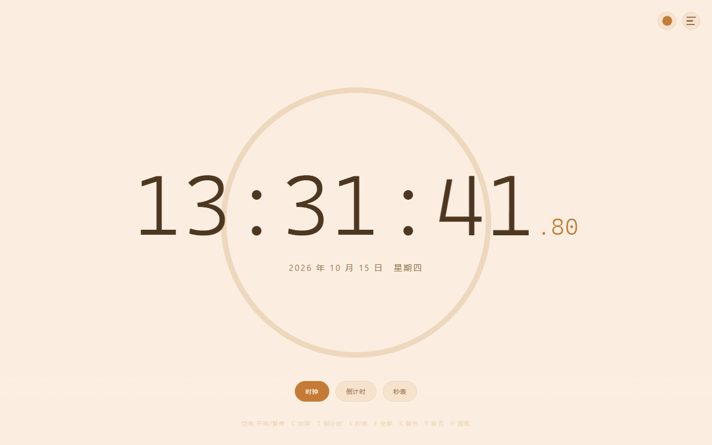

# 简约时钟 Simple Clock

一个**单文件、零依赖**的极简专注时钟：时钟 / 倒计时 / 秒表三合一，支持自定义倒计时时长、四种进度显示样式、九种柔和主题色，可安装到桌面离线使用。

> 在线体验：**https://aholic-ldk.github.io/focus-clock/**（部署后此链接生效）



## 功能特性

- **三种计时模式**：时钟（真实时间）/ 倒计时（1–999 分钟自由设定）/ 秒表（精确到百分秒）
- **主次分离**：时钟始终居中主位，倒计时 / 秒表在其正下方以副计时呈现，互不遮挡
- **四种进度样式**：不显示进度 / 底部进度条 / 环形进度 / 双进度环（外圈秒、内圈分钟）
- **九种柔和主题**：低饱和浅色背景（红橙黄绿青蓝紫 + 黑白），颜色与样式选择器收于右上角，点击展开
- **毫秒级显示**：时钟显示百分秒，秒表精确到 0.01s
- **状态记忆**：主题色、显示样式、倒计时时长自动保存，下次打开保持原样
- **可安装 PWA**：通过 manifest + Service Worker 支持「添加到桌面 / 主屏」，安装后离线可用

## 键盘快捷键

| 按键 | 功能 |
|---|---|
| `空格` | 开始 / 暂停 |
| `C` / `T` / `S` | 时钟 / 倒计时 / 秒表 |
| `F` | 全屏 |
| `K` / `Y` | 打开颜色 / 样式面板 |
| `1` – `9` | 快速切换主题色 |
| `H` | 显示 / 隐藏控制面板 |

## 使用方式

**本地使用**：下载 `index.html`，双击即可在浏览器打开，无需安装任何环境。

**部署到自己的 GitHub Pages**：

```bash
# 1. 在 GitHub 新建仓库（如 focus-clock），把本目录全部文件推上去
git init && git add . && git commit -m "init: focus clock"
git remote add origin git@github.com:<你的用户名>/focus-clock.git
git push -u origin main

# 2. 仓库 Settings → Pages → Source 选 main 分支 → Save
# 3. 稍等片刻，访问 https://<你的用户名>.github.io/focus-clock/
```

## 技术说明

- 全部代码（HTML / CSS / JS）内联于单个 `index.html`，约 28 KB，无任何外部依赖、无需构建
- 图标由脚本程序化生成（PNG，深色圆角底 + 表盘指针造型）
- PWA：`manifest.json` 定义应用元信息，`sw.js` 缓存应用外壳实现离线访问
- 数据全部存于浏览器 `localStorage`，不采集任何用户数据

## License

[MIT](LICENSE)
